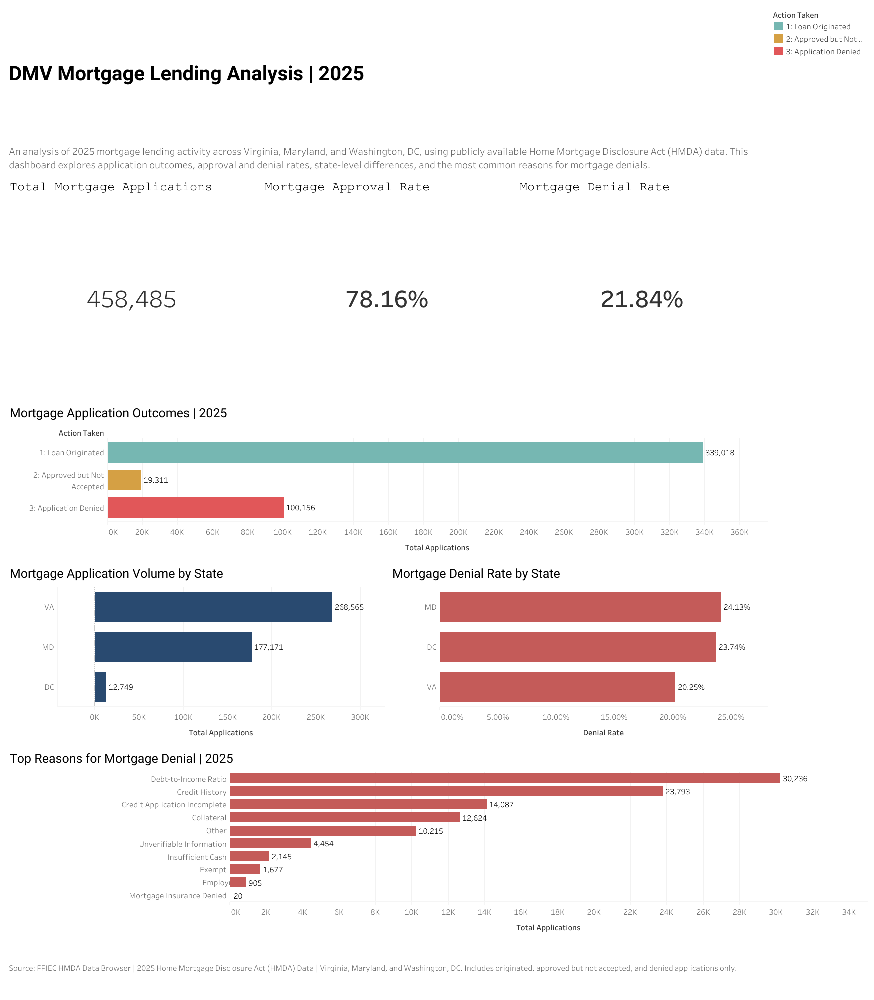

# DMV Mortgage Lending Analysis | 2025

## About This Project

For this project, I wanted to take a closer look at mortgage lending across Virginia, Maryland, and Washington, DC. Since these areas are part of the same broader region but have different housing markets, I was interested in seeing how mortgage application outcomes compared between them.

I used publicly available 2025 Home Mortgage Disclosure Act (HMDA) data and built a Tableau dashboard to explore application volume, approval and denial rates, and the reasons certain applications were denied.

Rather than just looking at how many people applied for mortgages, I wanted to understand what happened to those applications and whether the results differed depending on the state.

## Tableau Dashboard

### Dashboard Preview

**[Tableau Dashboard](https://public.tableau.com/app/profile/maaz.foshanji/viz/DMVMortgageLendingAnalysis2025/DMVMortgageLendingDashboard)**

## Tools and Data

- **Tableau Public:** Built the visualizations, calculated approval and denial rates, and designed the final dashboard.
- **HMDA Data Browser:** Retrieved mortgage lending data and applied the filters needed for the analysis.
- **CSV:** Used to transfer the dataset into Tableau.

The dataset contains **458,485 mortgage application records** from 2025, covering Virginia, Maryland, and Washington, DC.

I focused on three application outcomes: loans that were originated, applications that were approved but not accepted, and applications that were denied.

Because I excluded other outcomes, the percentages in this project are based only on those three categories.

## Mortgage Lending Overview

After importing the data into Tableau, I created calculated fields to measure the total number of applications and the percentage that were approved or denied.

Here is what the data showed:

| Mortgage Application Outcome | Total |
|---|---:|
| Total Applications | 458,485 |
| Loans Originated | 339,018 |
| Approved but Not Accepted | 19,311 |
| Applications Denied | 100,156 |
| Approval Rate | 78.16% |
| Denial Rate | 21.84% |

The majority of applications in the dataset were either originated or approved. However, more than 100,000 applications were denied, which made me interested in exploring where denials were more common and what reasons lenders reported.

## What I Found

### Mortgage Lending Across the DMV

Virginia had the highest number of mortgage applications among the three jurisdictions. However, having the most applications didn't mean it had the highest denial rate.

Maryland had the highest denial rate at **24.13%**, while Virginia's was **20.25%**.

This was one of the more interesting findings because it showed how looking at application counts alone could give an incomplete picture of lending activity. Comparing percentages alongside total applications made the differences between states easier to understand.

### Why Mortgage Applications Were Denied

I also looked at the first reported denial reason for applications that were denied.

The three most common primary denial reasons were:

| Reason for Denial | Number of Applications |
|---|---:|
| Debt-to-Income Ratio | 30,236 |
| Credit History | 23,793 |
| Credit Application Incomplete | 14,087 |

Debt-to-income ratio appeared most frequently, followed by credit history.

I found this part especially useful because it helped connect the overall denial numbers to the specific reasons reported by lenders. Instead of only knowing how many applications were denied, I could see which reasons appeared most often.

These are reported denial reasons, so the results describe patterns in the data rather than proving why an individual applicant was denied.

## Building the Dashboard

I started by downloading the 2025 mortgage lending data from the HMDA Data Browser. I filtered it to the three DMV jurisdictions and selected the application outcomes I wanted to compare.

After importing the CSV file into Tableau, I created calculated fields for total applications, approved applications, denied applications, approval rate, and denial rate.

From there, I built several visualizations to answer different questions:

- How many mortgage applications were submitted in the selected dataset?
- What percentage were approved or denied?
- Which state had the highest application volume?
- How did denial rates compare across the DMV?
- What were the most frequently reported primary reasons for denial?

I combined these charts into one dashboard, using consistent colors and labels to make the results easier to follow.

## What I Learned

This project gave me more experience working with a large real-world dataset and turning raw information into something people can actually use.

One thing I learned was how important it is to choose the right metric. For example, Virginia had the highest application volume, but Maryland had the highest denial rate. If I had only compared total applications, I would have missed that difference.

I also became more comfortable using Tableau calculated fields, building charts, and organizing several visualizations into a dashboard that tells a clear story.

This project helped me practice the type of work I'm interested in doing as a business or data analyst: asking questions, working through the data, and explaining what the results mean.

## Data Source

**Home Mortgage Disclosure Act (HMDA) — 2025**

Source: [FFIEC HMDA Data Browser](https://ffiec.cfpb.gov/data-browser/)

Geographic coverage: Virginia, Maryland, and Washington, DC.

The analysis includes only originated, approved-but-not-accepted, and denied applications. Approval and denial rates are calculated using those selected outcomes.
